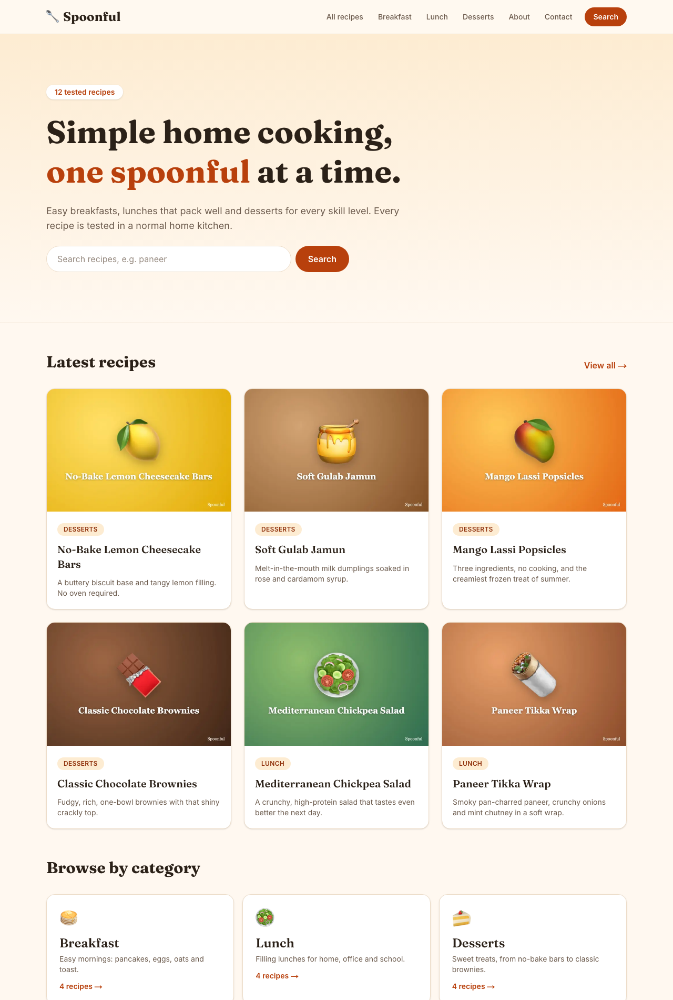
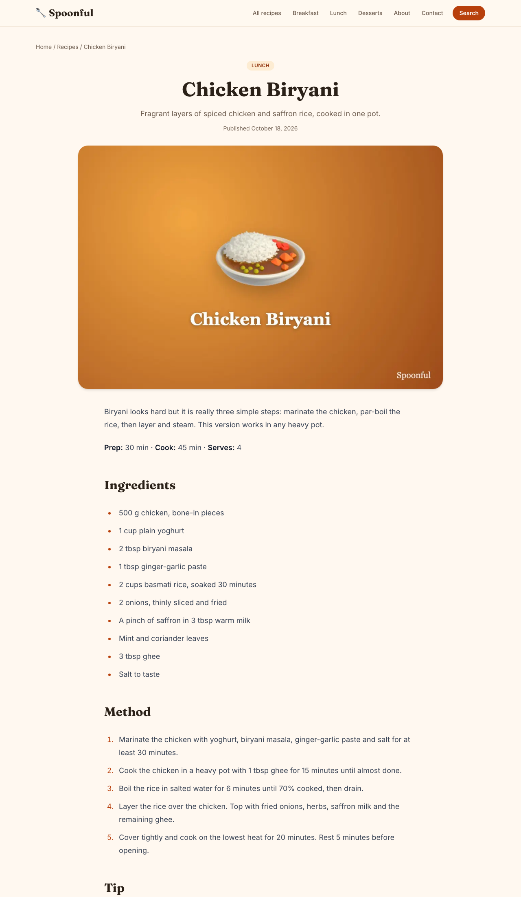
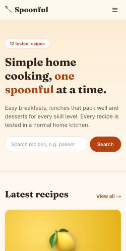
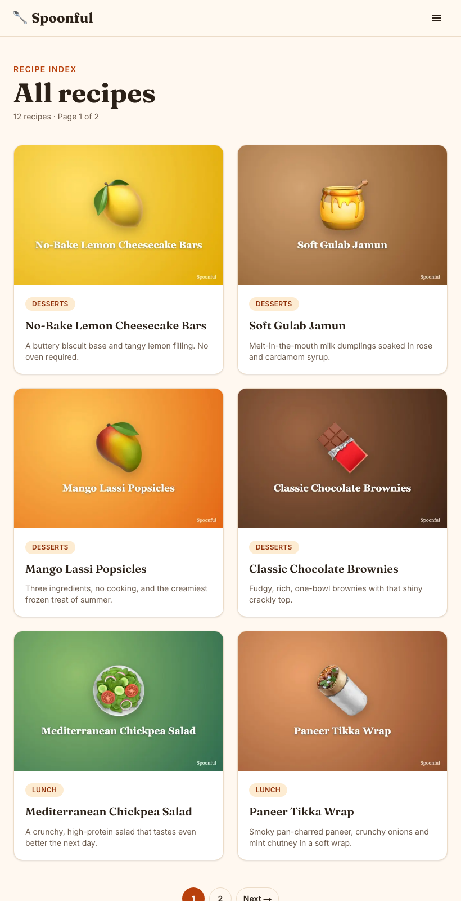
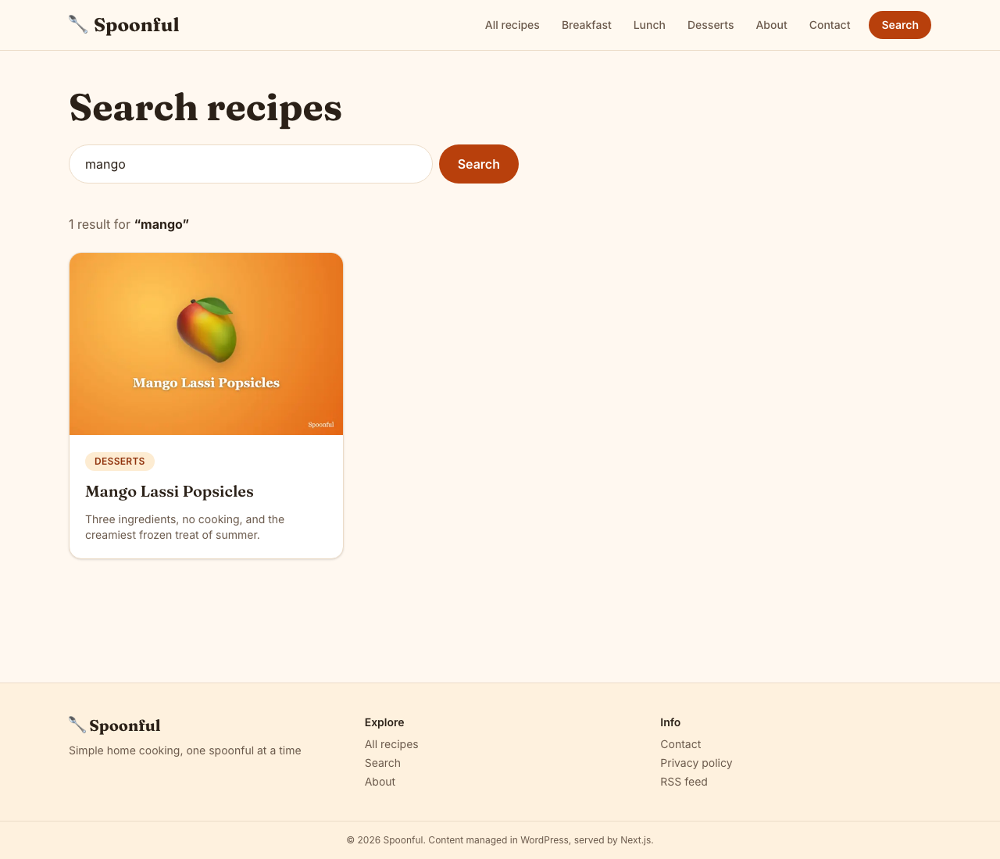
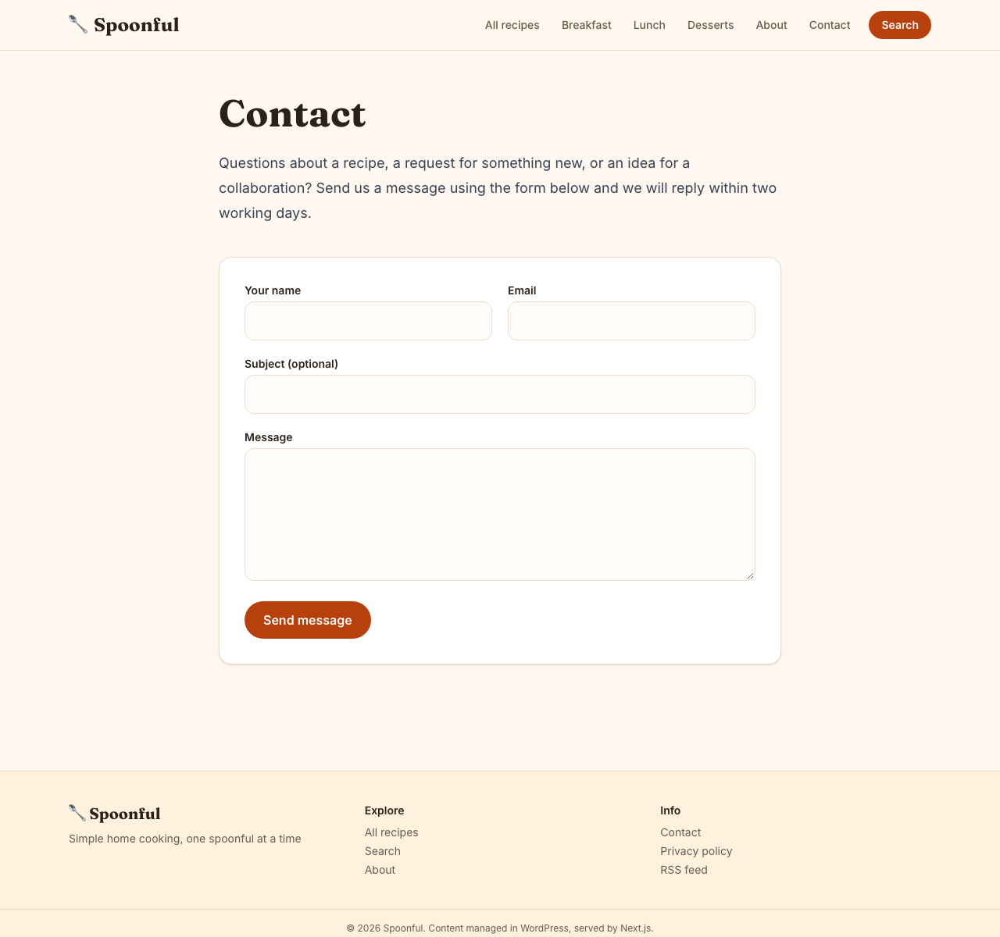
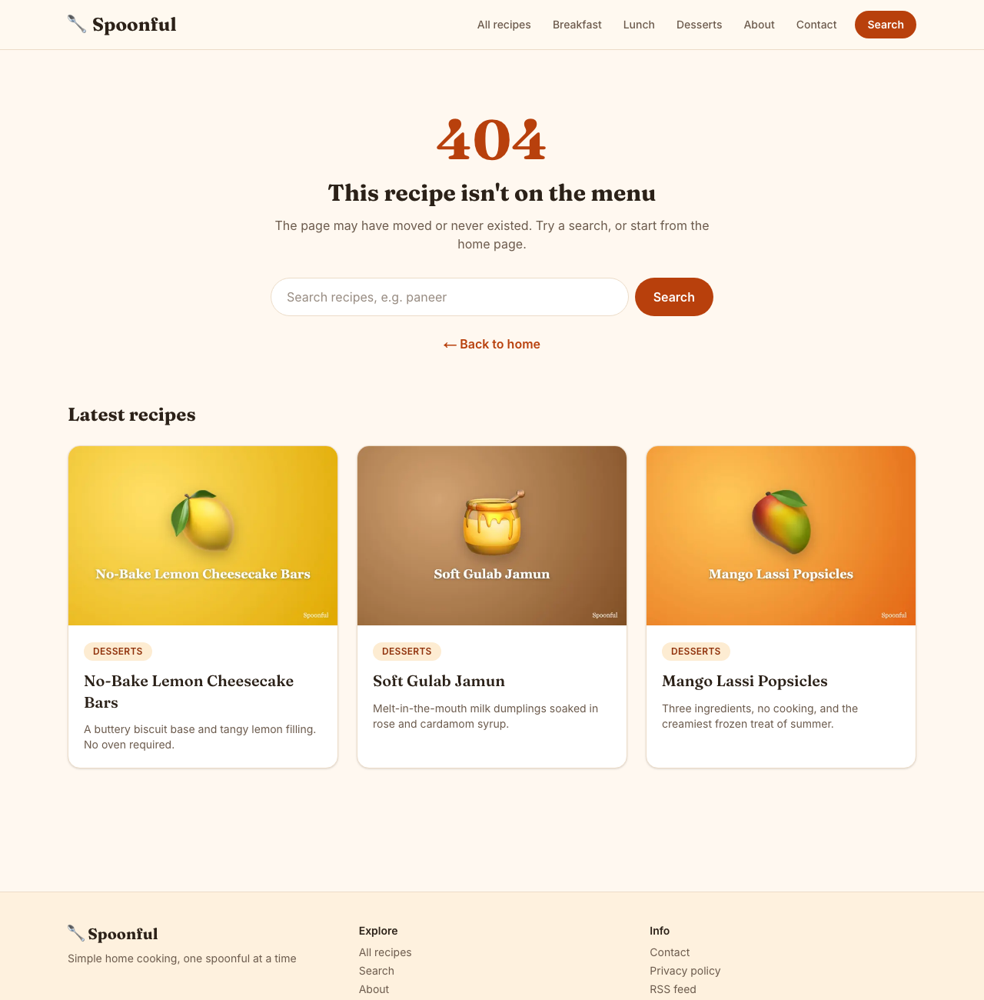

# 🥄 Spoonful: WordPress → Next.js migration

A recipe blog that started as a normal **WordPress** site and was rebuilt as a **headless** frontend in
**Next.js 16 (App Router) + TypeScript + Tailwind CSS**, with WordPress still used as the CMS through the
**REST API**.

The goal of the project: **nothing breaks during the move**. Same URLs, same SEO, same images, working forms.

**Live demo:** [spoonful-chi.vercel.app](https://spoonful-chi.vercel.app/) · **Migration write-up:** [MIGRATION.md](MIGRATION.md) · **Code walkthrough:** [docs/CODE-WALKTHROUGH.md](docs/CODE-WALKTHROUGH.md)



## Features

- **Headless WordPress**: posts, pages, categories, tags, media and Yoast SEO data come from `/wp-json/wp/v2`
- **All data access in one file** ([`lib/wordpress.ts`](lib/wordpress.ts)) with TypeScript types for Post, Page, Category, Tag and Media
- **Same URLs as WordPress**: `/recipes/{slug}/`, `/category/{slug}/page/2/`, `/tag/{slug}/`, `/about/`, `/feed/` …
- **301 redirects** for old URL formats (`/?p=123`, date-based permalinks, `/page/2/`, …)
- **Yoast SEO → `generateMetadata`**: title, description, canonical, Open Graph, Twitter, JSON-LD schema
- **`next/image`** for featured images *and* images inside post content
- **Contact form** rebuilt in React, posting to a validated route handler that emails through Resend
- **ISR**: static pages refreshed every hour, plus instant refresh from a WordPress webhook
- **`sitemap.xml`, `robots.txt`, RSS feed**, canonical URLs, noindex on search
- Pagination from the **`X-WP-TotalPages`** header, search with **`?search=`**
- Loading skeletons, error boundary with retry, custom 404
- Responsive on mobile, tablet and desktop. Lighthouse Accessibility, Best Practices and SEO all score 100
- Works **without a WordPress server**: falls back to a JSON snapshot of the REST API (great for free hosting)

## Screenshots

| Recipe page | Mobile | Tablet |
|---|---|---|
|  |  |  |

| Search | Contact form | Custom 404 |
|---|---|---|
|  |  |  |

## Tech stack

| | |
|---|---|
| CMS | WordPress 6 (LocalWP), Yoast SEO, Contact Form 7 → REST API |
| Frontend | Next.js 16 App Router, React 19, TypeScript |
| Styling | Tailwind CSS v4 + `@tailwindcss/typography` |
| Email | Resend REST API (optional) |
| Hosting | Vercel |

## How to run

**Requirements:** Node.js 20+.

```bash
git clone https://github.com/md-asad-shaik/spoonful.git
cd spoonful
npm install
cp .env.example .env.local
npm run dev            # http://localhost:3000
```

With `WORDPRESS_URL` empty, the app uses the bundled snapshot (`data/wordpress.json`), so it works immediately.

**With your own WordPress** (see [wordpress/README.md](wordpress/README.md) to set it up in 10 minutes):

```bash
# .env.local
WORDPRESS_URL=http://spoonful.local
```

| Command | What it does |
|---|---|
| `npm run dev` | Development server |
| `npm run build && npm start` | Production build (this is what Lighthouse should test) |
| `npm run lint` / `npm run typecheck` | ESLint / TypeScript checks |
| `npm run data:export` | Save WordPress content + images into `data/wordpress.json` and `public/wp-content/uploads/` |
| `npm run data:sample` | Rebuild the sample snapshot from `wordpress/seed/content.json` (no WordPress needed) |

### Environment variables

| Name | Required | Purpose |
|---|---|---|
| `WORDPRESS_URL` | no | WordPress address. Empty = use the JSON snapshot |
| `NEXT_PUBLIC_SITE_URL` | recommended | Public URL for canonicals, Open Graph, sitemap (auto-detected on Vercel) |
| `REVALIDATE_SECRET` | for webhook | Shared secret for `POST /api/revalidate/` |
| `RESEND_API_KEY`, `CONTACT_TO_EMAIL`, `CONTACT_FROM_EMAIL` | no | Send contact emails. If empty, messages are logged |

## Project structure

```
app/                      Routes (App Router). Folder = URL.
  page.tsx                /                     home: hero, latest 6, categories
  recipes/page.tsx        /recipes/             all recipes, page 1
  recipes/page/[page]/    /recipes/page/2/
  recipes/[slug]/         /recipes/{slug}/      recipe + related recipes
  category/[slug]/        /category/{slug}/     (+ /page/[page]/)
  tag/[slug]/             /tag/{slug}/
  [slug]/                 /about/, /privacy/    WordPress pages
  contact/                /contact/             WP intro text + React form
  search/                 /search/?q=
  api/contact/route.ts    POST: validate + email
  api/revalidate/route.ts POST: on-demand ISR (WordPress webhook)
  feed/route.ts           /feed/                RSS
  sitemap.ts, robots.ts   /sitemap.xml, /robots.txt
  layout.tsx, loading.tsx, error.tsx, not-found.tsx
components/               Header, Footer, RecipeCard, Pagination, CategoryBadge, ContactForm, ...
lib/
  wordpress.ts            ALL WordPress data access + types
  seo.ts                  Yoast → Next.js Metadata
  redirects.ts            301 redirect rules
  html.ts, contact.ts, site.ts, params.ts
proxy.ts                  /?p=123 style redirects
next.config.ts            trailingSlash, images, redirects, rewrites
data/wordpress.json       REST API snapshot
wordpress/                Phase 1: seed script, content, images, webhook plugin
scripts/                  export-wordpress.mjs, generate-sample-data.mjs
```

## Lighthouse scores

Mobile emulation, Lighthouse 13.6, production build.

| Page | Performance | Accessibility | Best Practices | SEO |
|---|---|---|---|---|
| Home | **94** | **100** | **100** | **100** |
| Recipe | **96** | **100** | **100** | **100** |

Measured on `next build && next start` (LCP 2.8–3.0 s, CLS 0, TBT 10 ms).
The live demo runs on the bundled REST API snapshot (`data/wordpress.json`). To compare against a running
WordPress site, set one up with [wordpress/README.md](wordpress/README.md) and measure it the same way (step 5).

## Deploying to Vercel

1. Push this repo to GitHub.
2. On <https://vercel.com> → **Add New → Project** → import the repo. Framework is detected as Next.js.
3. Environment variables (Settings → Environment Variables):
   - **Snapshot mode (free, simplest):** leave `WORDPRESS_URL` empty. The site uses `data/wordpress.json`.
     To publish new WordPress content later: run `npm run data:export` locally, commit, push, and Vercel redeploys.
   - **Live WordPress:** host WordPress publicly (see below), set `WORDPRESS_URL=https://your-wp-site`.
   - Optional: `REVALIDATE_SECRET`, `RESEND_API_KEY`, `CONTACT_TO_EMAIL`.
4. Deploy. Then set `NEXT_PUBLIC_SITE_URL` to the final domain and redeploy.

### Hosting WordPress for free (optional, for live mode)

LocalWP only runs on your computer, so Vercel can't reach it. Options:

- **InstaWP** (<https://instawp.com>): free sandbox sites. Upload your LocalWP site with the *InstaWP Connect*
  plugin, or create a new site and run the same seed (`wp eval-file`) in InstaWP's WP-CLI. Free sites can expire,
  which is why snapshot mode is the default here.
- Any PHP host. Then add `SPOONFUL_REVALIDATE_URL` / `SPOONFUL_REVALIDATE_SECRET` to `wp-config.php` and install
  `wordpress/mu-plugins/spoonful-revalidate.php` so saves update the site instantly.

## Built in phases

| Phase | Branch | Contents |
|---|---|---|
| 1 | `phase-1-wordpress-setup` | LocalWP guide, seed script, sample content, images |
| 2 | `phase-2-nextjs-data-layer` | Next.js project, `lib/wordpress.ts`, types, snapshot + export scripts |
| 3 | `phase-3-pages` | Layout, components, all pages, loading / error / 404 |
| 4 | `phase-4-migration-checklist` | Redirects, Yoast metadata, contact form + API, ISR webhook, MIGRATION.md |
| 5 | `phase-5-seo-deploy` | sitemap, robots, RSS, screenshots, README, deployment |
